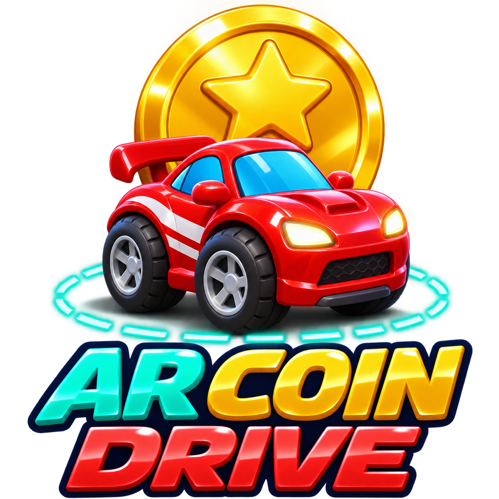

# AR Coin Drive

- [Transparent app icon foreground layer (PNG)](Branding/app-icon-foreground.png)
- [Opaque app icon background layer (PNG)](Branding/app-icon-background.png)

A small Unity AR toy-car game for Android. The player scans and taps a horizontal surface, a toy racetrack or battle ring is drawn on it (attached to an AR anchor), and the player races or battles a computer rival. Without AR the same game runs on a landscaped virtual island.

## Modes

- **Race:** five laps of a closed toy track against a rival car. Hold GO for a 3-2-1 countdown. Laps only count when driving forward, coins on the road give a short speed boost and respawn, cars bump each other, and the best finishing time is saved.
- **Battle:** a round sumo ring that shrinks from 124 cm to 60 cm across during a round. Ram the rival to knock it out of the ring; harder hits send cars further. First to three knockouts wins the match.
- Switch modes with the MODE button on the starting grid or after a finish.
- **Two players, no server:** both phones join the same Wi-Fi, or one phone turns on its hotspot and the other connects to it. Each player places the track on their own floor (or uses the virtual island). One taps 2 PLAYERS > HOST, the other 2 PLAYERS > JOIN; the joining phone finds the host automatically by sweeping its local subnet over UDP port 47777. The host runs the game and picks the mode; the other phone sends its controls and shows the host's game from its own car. Works in both Race and Battle. If the link drops for 4 seconds, the host goes back to racing the computer.

## Included

- Unity 6 project scaffold with AR Foundation and ARCore XR packages pinned to 6.6.2.
- Editor menu command that generates the AR session, camera rig, visible translucent plane mesh, horizontal and vertical plane detection, raycast and occlusion managers, and demo scene.
- Optional environment-depth sampling that can stop the player's car near visible obstacles on supported devices.
- Procedural models built in code: a glossy toy sports car with rolling and steering wheels and body roll (`ProceduralCarModel`, `ProceduralCarRig`), the race track with curbs, start grid and guard rails (`RaceTrack`), and the battle ring (`BattleArena`). No third-party models are required.
- `Resources/ARCoinDriveToon.shader`: a mobile paint shader with wrapped light, a glossy clear coat and a procedural sky reflection; every procedural material uses it through `Resources/ARCoinDriveLit.mat`, so it ships in builds.
- Multi-touch controls: hold a steering arrow and GO/BACK with two thumbs at once (WASD/arrow keys in the Editor).
- Toy RC-car handling shared by the player and the rival: acceleration, braking, rolling friction, steering only while moving, slower on grass, and sliding along guard rails.

## Open and run

1. Open this folder with Unity 6.0 (6000.0) or a compatible later Unity 6 editor. Let Package Manager resolve the packages.
2. Switch the build target to Android.
3. In Edit > Project Settings > XR Plug-in Management, ARCore is already the only Android loader, and both ARCore and ARCore Depth are set to Optional, so the game installs on any Android 10+ phone (see "Without AR" below). Verify this if Unity asks to install XR Plug-in Management.
4. After pulling updates, run Tools > AR Coin Drive > Create Demo Scene again. This regenerates Assets/Scenes/ARCoinDriveDemo.unity, creates the plane-visualizer prefab/material, and sets Android minimum API level to 29 (Android 10), matching ARCore's Vulkan requirement.
5. Connect an ARCore-compatible Android phone, enable USB debugging, and build/run. The Unity Editor does not provide live AR camera tracking.
6. Slowly move the phone to scan a textured, well-lit floor. Detected planes are tinted teal (the tint hides once the arena is placed). Tap a horizontal floor or tabletop (not a wall) to place the arena, then press GO to start the timer and steer with the arrows while holding GO or BACK.

## Without AR

- On start the game runs `ARSession.CheckAvailability()`. If the device cannot run AR, it switches automatically to a virtual table: a 3D tabletop with the same arena, rounds and controls, viewed through a chase camera.
- If ARCore is supported but not installed, ARSession asks the player to install Google Play Services for AR. The scanning screen also has a PLAY WITHOUT AR button for declined installs, missing camera permission, or a room that is too dark to track.
- In the Editor AR is unavailable, so the virtual table starts automatically, which makes quick gameplay testing possible without a phone.
- `ARRigSetup` repairs older generated scenes at runtime: it adds the camera TrackedPoseDriver (without it the camera never follows the phone), an ARAnchorManager, and plane visuals when no plane prefab is assigned.

## Current prototype limits

- This is a playable AR foundation check, not a finished game.
- The play boundary is virtual and fixed at 1.5 m square. The play area is attached to a plane anchor when the provider supports trackable attachments.
- The prototype requests vertical plane detection and stops the car near some tracked flat vertical surfaces. This does not recognize every object or guarantee safe real-world collision avoidance.
- On supported devices, environment-depth sampling provides an approximate proximity guard and environment occlusion for visible objects. It is geometric depth sampling, not AI object recognition or complete room reconstruction.
- Depth readings depend on device support, camera angle, tracking, and visibility. The app falls back to vertical-plane checks when depth is unavailable; both paths need real-phone testing.
- The car and coins are procedural placeholder models intended to prove scale and interaction. Replace them with authored stylized assets during visual production.
- The project has not been built or checked on a physical Android device in this environment.

## Packages

- com.unity.xr.arfoundation 6.6.2
- com.unity.xr.arcore 6.6.2
- com.unity.xr.management 4.7.0
